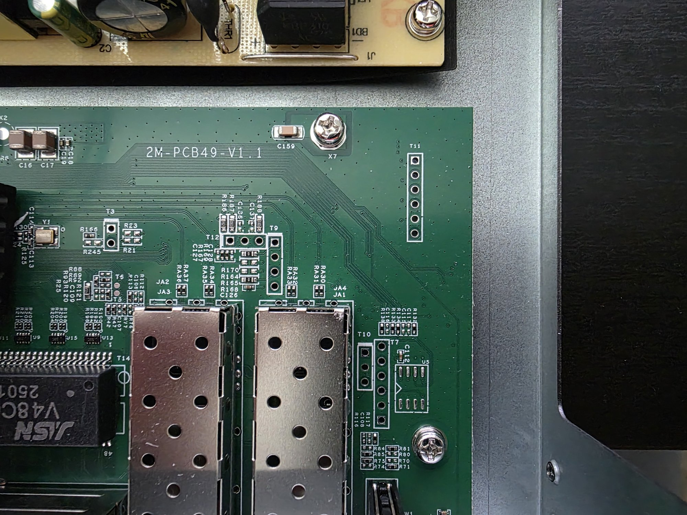
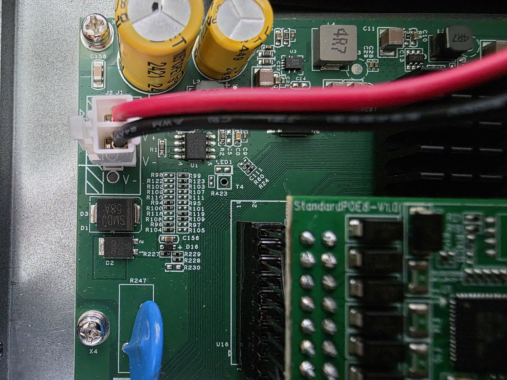
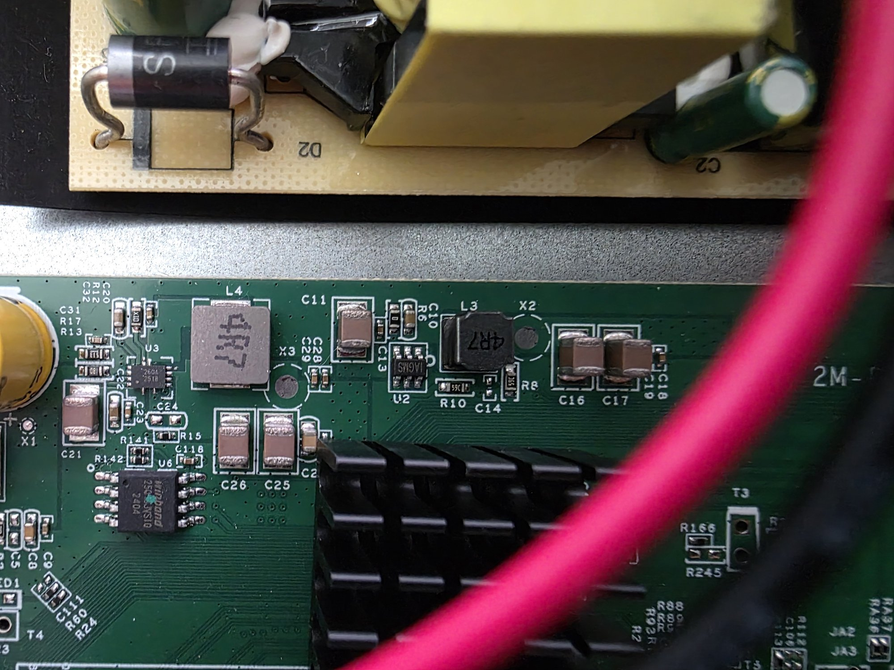

# MokerLink POE-2G040210GSM (2M-PCB49-V1.1)

The PoE version of the MokerLink 2G040210GSM web-managed 4+2 switch. Work in progress: RTLPlayground boots
on it with the machine target `POE_2G040210GSM`, but most of the board is still to be checked.

> [!CAUTION]
> This switch has its power supply inside and runs from mains voltage, which can be a dangerous or
> potentially lethal hazard. High-voltage capacitors can stay charged after it is unplugged. Unplug
> it and let the capacitors discharge before opening it or probing the board.

### Label specifications

- **Name**: 4-port 2.5G PoE web-managed switch
- **Model**: POE-2G040210GSM
- **Ports**:
  - 4 × RJ45: 10/100/1000/2500 Mbps, PoE
  - 2 × SFP+: 1000 / 2500 / 10000 Mbps

### Machine target

`make MACHINE=POE_2G040210GSM`

| | 2G040210GSM | POE-2G040210GSM |
| --- | --- | --- |
| PCB | `2M-PCB43-V1.1` | `2M-PCB49-V1.1` |
| Target | `KP_9000_6XHML_X2_V1_1` | `POE_2G040210GSM` |
| Status | supported ([doc](2M-PCB43-V1.1.md)) | boots, partly tested |

`POE_2G040210GSM` started as a copy of `KP_9000_6XHML_X2_V1_1`, as both are RTL8372 4+2 designs
from the same vendor. Its header layout is closer to the [2M-PCB23-V3.1](2M-PCB23-V3_1.md)'s, though.

### What works

Tested on one switch, flashed with a CH341A clip:

- It boots and serves the web UI. Chip temperature and the 2 MB flash are detected.
- All four RJ45 ports link at 1G and pass traffic, each on the matching front-panel port. 2.5G
  is not tested yet.
- The LEDs, mapped on this board (see [LEDs](#leds)). Each port's amber LED lights and blinks
  with a 1G link; the green (2.5G) and SFP LEDs are mapped but not yet seen lit by a real link.
- The MAC address is read from the stock firmware's copy at flash offset `0x1FC000`. Keep that
  sector when flashing a full image with a clip: an image padded with `0xFF` erases it, and the
  switch then makes up a locally administered MAC.

Not known yet: the SFP pins, the reset button, and whether PoE works (see [PoE](#poe)).

### PCB overview

**Board markings**
- Top silkscreen: 2M-PCB49-V1.1
- PoE daughterboard: StandardPOE8-V1.0

**Key components**
- RTL8372 (presumably) under the heatsink, with crystal `Y1` next to it
- `U6`: flash, Winbond W25Q16JVSIQ, 2 MiB
- `U5`: an unpopulated SOIC-8 footprint next to `T7`, like `U7` on the 2M-PCB23-V3.1 (an I²C
  EEPROM on the slave interface's bus)
- `U16`: a 2×10 socket for the PoE daughterboard, under its left edge, between the power input
  and the heatsink. Pin 1 is at the front end, towards the RJ45 ports (a triangle on the top
  silkscreen, the square pad on the bottom); pins 19 and 20 are at the back, near `T4`. Its
  solder joints are easiest to reach from the bottom, with the daughterboard plugged in.
- `T14`: V48C01S magnetics for the four RJ45 ports
- `JA1`-`JA4`: the two SFP+ cages
- `J1`/`J2` (`V+`, `V-`): power from the internal supply board, whose label reads "72W REV:A"

The flash's 2 MiB means the standard layout applies (web updates need no `LAYOUT=compact`), and the
default dual-I/O flash reads should work (`flash_sio` stays 0). For a backup with a CH341A, flashrom
names the chip `W25Q16.V`.

Top side, with the PoE daughterboard and the supply board above it:

Headers `T3`, `T7`, `T9`-`T12` and `U5`:

Power input `J1`/`J2` and the daughterboard connector `U16`:

Flash `U6`:

Bottom:

### PoE

As on the other PoE boards (see [supported devices](../supported_devices.md)), RTLPlayground doesn't
configure PoE.

- **Controller:** an RTL8238B (`U1`) on the StandardPOE8-V1.0 daughterboard, an 8-channel design
  of which 4 are used. It plugs into `U16` on the main board. The RTL8238B is the daughterboard's
  only chip: its `U2` footprint is unpopulated, so there is no separate microcontroller on it. The
  daughterboard also has a 4-pad row on its right edge, perhaps for programming or a UART. The
  [Hasivo S1100P](Hasivo-S1100P-8GT-1SX-S.md) also has an RTL8238B, managed there by a separate
  STC8H8K64U microcontroller. (The MokerLink POE-2G080110GS, [2M-PCB51-ML-V1.1](2M-PCB51-ML-V1_1.md),
  uses an RTL8238C.)
- **`U16` pins** (measured with the switch unplugged; diode mode with the black probe on GND):
  - 17, 18: GND, the same net as `J2` (V-).
  - 8: 3V3. Reads about 1.2 V in diode mode.
  - 1-6: signals. Each reads about 1.6 V in diode mode, which is about 0.4 V above the 3V3 rail:
    the ESD diode of a 3.3 V chip pin. 1, 3 and 5 read a few tens of kΩ to 3V3: weak pull-ups,
    or a path through the unpowered chips. 2, 4 and 6 gave no reading.
    None of 1-6 connects to a pin of `T7` or `T9`-`T12`.
  - 7, 9-16, 19, 20: nothing in diode mode, probably not connected on the main board.
  - None of them connects to `J1` (V+), so the PoE supply's positive side reaches the daughterboard
    some other way.
- **The stock firmware manages PoE.** Its web UI has a PoE power consumption readout and a "PSE
  Port Settings" page that turns PoE on and off per port and shows each port's type, power (W),
  voltage (V) and current (mA). With no microcontroller on the daughterboard, that means the RTL8372
  itself talks to the RTL8238B through `U16`, in both directions (the readings come back from it).
- **I²C, going by the stock firmware.** Its strings include `PSE IC Type: RTL8238b` and
  `address: 0x20 pse_init` / `address: 0x21 pse_init`, which point to the RTL8238B on an I²C bus at
  `0x20` and `0x21` rather than a UART. `GPIO50`/`GPIO51` are also the RTL8372's I²C bus 2.
- **Protocol on other boards** (unconfirmed here): RTL8238-based PoE is usually driven over a
  UART, 115200 8N1, 12-byte frames (`cmd, seq, 9 data bytes, checksum`), Realtek's dialect of the
  Broadcom PoE protocol ([realtek-poe#25](https://github.com/Hurricos/realtek-poe/issues/25)).
- **Under RTLPlayground, PoE may stay off.** RTLPlayground sends the RTL8238B nothing. Whether the
  ports still supply power then depends on what the RTL8238B does by itself after power-up, which
  isn't known. Check it before relying on PoE with RTLPlayground.
- **The left SFP's pins are suspect.** The target copied from the 2M-PCB43-V1.1 uses GPIO50 as the
  left SFP's module detect. If GPIO50/51 go to `U16` here (as UART1 or I²C bus 2), the left SFP's detect (and maybe LOS)
  must be on other pins, and the target is wrong.

### LEDs

Each RJ45 port has a green and an amber LED, and the left SFP port a green one. The LED pads were
found by routing pads to a lit source in turn, with `regset` on the LED mux registers
(`0x65e0`-`0x65f4`) while RTLPlayground ran:

| LED | Pad | | LED | Pad |
| --- | --- | --- | --- | --- |
| Port 1 amber | 9 | | Port 3 amber | 18 |
| Port 1 green | 10 | | Port 3 green | 21 |
| Port 2 amber | 12 | | Port 4 amber | 24 |
| Port 2 green | 15 | | Port 4 green | 25 |
| Port 5 (left SFP) | 26 | | | |

None of pads 8-27 lit a port 6 (right SFP) LED or a system LED. Pads 0-7 aren't tested.

The target lights the green LED for a 2.5G or 10G link and the amber LED for 1G, 100M or 10M, both
blinking on activity. The SFP LED shows any link and activity. Whether that matches the stock
firmware hasn't been compared.

Pad 10 is also GPIO10, which the 2M-PCB43-V1.1 uses as its left SFP's LOS input, so this target
doesn't use it for LOS.

### Headers

Pin 1 is the square pad. "Measured" is a continuity check on this board; everything else is a guess
from the 2M-PCB23-V3.1's matching headers and still has to be checked.

| Header | Pin | Signal | Source |
| --- | --- | --- | --- |
| `T3`, 2 pins | 1 | GND | measured |
| | 2 | ? | |
| `T7`, slave interface, 6 pins | 1 | SCL / SCK / MDC | guess (2M-PCB23-V3.1 `T7`) |
| | 2 | GND | measured |
| | 3 | SDA / SDI / MDIO | guess |
| | 4 | 3V3 | measured |
| | 5, 6 | GPIO? | guess |
| `T9`, serial console, 4 pins | 1 | U0TXD, GPIO31 (output) | guess (2M-PCB23-V3.1 `T8`) |
| | 2 | GND | measured |
| | 3 | U0RXD, GPIO32 (input) | guess |
| | 4 | 3V3 | measured |
| `T10`, SMI (port 6?), 3 pins | 2 | GND | measured |
| `T11`, GPIO?, 6 pins | 3 | 3V3 | measured |
| | 5 | GND | measured |
| `T12`, SMI (port 5?), 3 pins | 2 | GND | measured |

`T10` and `T12` look like the 2M-PCB23-V3.1's 3-pin SMI header `T9` (1 MDO, 2 GND, 3 MDC). `T11`
looks like its 6-pin `T10` (1 GPIO49, 2 GPIO47, 3 3V3, 4 GPIO48, 5 GND, 6 GPIO46). The board also
has `T4`, `T5` and `T6`, not yet looked at.

The slave interface on `T7` should answer at I²C address `0x5c` with chip ID `0x83720000` (register
`0x0004`) if the `IF_SEL` straps select I²C, as on the other boards. `U5` next to it supports that.

### Still open

- Photos of the front and the label.
- The RTL chip's marking, to confirm the RTL8372.
- What `U16` carries: continuity from its pins to the RTL8372 side, above all to GPIO50/51
  (UART1) and the I²C buses. A logic analyser on the `U16` pins while the stock web UI changes a
  port's PoE setting would show the link and its protocol.
- Whether the ports supply PoE when the RTL8238B gets no commands (under RTLPlayground).
- The serial console on `T9`: baud rate and the stock firmware's boot log.
- 2.5G links and the green LEDs, the port 6 and system LEDs.
- SFP pins (module detect, LOS, I²C) and the reset button. These can be read from
  the stock firmware's pin-mux, GPIO and LED registers over `T7` while it runs.
- What `T3` is: a 2-pin header with pin 1 on GND, next to the crystal `Y1`, so perhaps a button or
  jumper input (the reset button?).

## Power supply

An internal supply board, labelled "72W REV:A", runs from mains and feeds the main board through
`J1`/`J2` (`V+`, `V-`). Its output voltage is still to be measured.
